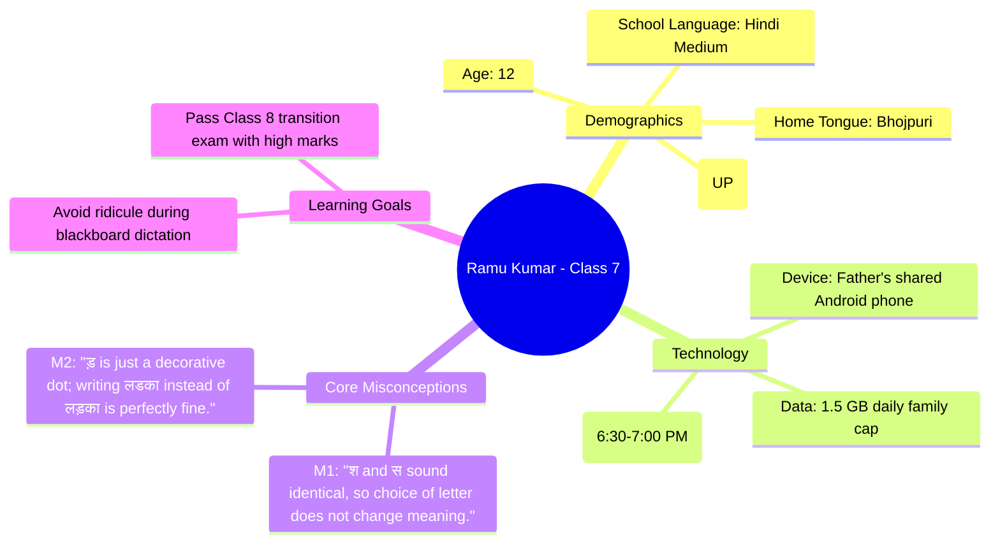

# 🎓 ET 617 End-Semester Examination: Complete Submission Dossier

**Student Roll No:** 24B1297  
**Date:** Wednesday, 18 November 2026 (6:00 PM – 9:00 PM)  
**Course:** ET 617 - Educational Application Design (IIT Bombay)  
**Instructor:** Prof. Ramkumar Rajendran  

---

## 1. Exam Identity Card Verification

| Field | Chosen Option | Description & Rationale | Visible in App |
| :--- | :--- | :--- | :--- |
| **ID** | **24B1297** | Roll Number Token | Rendered on persistent footer of all screens & `/about` |
| **P** | **P2** | Contextual Language & Literacy Application | Natural language dialogue, dialect variation diagnosis |
| **T** | **T10** | Hindi for Bhojpuri-speaking learners: श/स and ड़ | Contrasts palatal /ʃ/ vs dental /s/, and retroflex flap /ɽ/ |
| **L** | **L1** | Class 6–8 rural govt school student, parent's phone, 30 min | Low cognitive load, bite-sized tasks, Devanagari keyboard |
| **C** | **C2** | Learner's own language (Hindi native UI + English toggle) | Complete Hindi instructions with bilingual switch on lessons |

* **Live Hosted Application:** 👉 [https://et617-24b1297.vercel.app](https://et617-24b1297.vercel.app)
* **GitHub Repository:** 👉 [https://github.com/GarvitGarg2005/et617-endsem-24b1297](https://github.com/GarvitGarg2005/et617-endsem-24b1297)

---

## 2. Complete Deliverables (D1 – D8)

### D1 — Educational Problem Statement
In rural Hindi-medium schools across eastern UP and Bihar, Bhojpuri-dominant learners face severe phonological interference when acquiring standard written Hindi (खड़ी बोली). In Bhojpuri phonology, the palatal fricative /ʃ/ (**श**) merges into the dental fricative /s/ (**स**), causing phonetic homophony. Simultaneously, the retroflex flap /ɽ/ (**ड़**), distinguished by a bottom *nukta*, is frequently merged with the un-nukta plosive [ɖ] (**ड**). Consequently, students conflate words with distinct semantic meanings (e.g. शेर [lion] vs सेर [measure]) and routinely omit the nukta in common words like लड़का and सड़क. Traditional educational tools either penalize regional dialect features as illiterate errors or fail to provide auditory contrast.

* **Target Context:** A Class 7 student accessing the application on a parent's shared budget Android phone in the evening (15–20 minutes session).
* **Measurable Learning Outcomes:**
  1. *Identify (पहचानना):* Given visual cues or speech prompts, the learner will correctly identify whether standard Hindi requires **श** or **स** with $\ge 85\%$ accuracy.
  2. *Distinguish (अंतर करना):* The learner will explain the difference between acceptable oral dialectal variations (e.g., Bhojpuri "सादी") and formal standard orthography ("शादी").
  3. *Apply (प्रयोग करना):* The learner will apply correct nukta orthography (**ड़**) and sibilant consonants (**श/स**) in sentence construction and communicative dialogue.

---

### D2 — Learner Persona: Ramu Kumar



* **Prior Knowledge:** Mastered primary Devanagari consonants and vowels; can read simple textbook sentences.
* **Misconception 1 (M1):** Believes that because "शेर" (lion) and "सेर" (unit of measure) sound indistinguishable in his dialect, they can be used interchangeably.
* **Misconception 2 (M2):** Believes the nukta diacritic in "ड़" is an optional stylistic accent rather than a phonemic distinction.

---

### D3 — Educational Content & Assessment Items

The app implements a full structured pedagogical sequence:
1. **Lesson 1:** श और स का अंतर (Palatal vs Dental articulation model + audio)
2. **Lesson 2:** ड़ को पहचानो (Visual stop vs flap contrast + nukta rule)
3. **Lesson 3:** वाक्य में प्रयोग (Contextual sentence usage and Bhojpuri sociolinguistic notes)
4. **Interactive Practice:** 8 items across 4 formats:
   * *MCQ (Semantic Contrast):* "___ेर" (lion) $\rightarrow$ शेर vs सेर.
   * *Fill-in-the-Blank:* "मेरे ___दोसी बहुत अच्छे हैं।" (with on-screen Hindi keyboard).
   * *True/False:* "शक्ति को सक्ति लिखना सही है।" (diagnoses Bhojpuri phonological transfer).
   * *Interactive Matching:* Pairs words (शेर, सेब, लड़की, शाम) to definitions.
5. **AI Conversational Practice:** Natural language dialogue with real-time dialect recognition.

---

### D4 — Application Architecture & Screen Flow

```
[/ (Welcome)] ──> [/home (Dashboard)] ──┬──> [/lesson/sha-sa (Lesson 1)]
                                        ├──> [/lesson/da (Lesson 2)]
                                        ├──> [/lesson/sentences (Lesson 3)]
                                        ├──> [/practice (8 Assessed Items)]
                                        ├──> [/chat (AI Conversational Tutor)]
                                        ├──> [/results (Real-time Analytics)]
                                        └──> [/about (Identity & Theories)]
```

* **Constraint C2 Visible Implementation:** All screens operate primarily in authentic Devanagari Hindi. Lessons feature an accessible **`🌐 English में देखें`** toggle.
* **Multimodal Scaffolding:** Each lesson includes an embedded **Interactive Phonetics Visualizer** displaying tongue-palate vocal tract placement and standalone **🔊 Audio Pronunciation Buttons**.
* **Devanagari Input Scaffold:** An integrated **On-Screen Hindi Virtual Keyboard** enables one-tap input on touch devices, with fallback support for Latin transliterations (e.g. typing `padosi`).

---

### D5 — Contrasting Learner Scenarios (Viva Demonstration Walkthrough)

#### Scenario A: Mastery / Correct Response Path
1. Learner enters name on `/` and opens `/practice`.
2. Selects **"शेर (श)"** for Question 1.
3. **System Behavior:** Instant green highlight (`bg-green-100`), positive reinforcement banner: *"✅ बिल्कुल सही! शेर 🦁 में 'श' आता है।"*
4. In `/chat`, learner types *"शेर जंगल का राजा है"*.
5. **AI Feedback:** *"शाबाश! तुमने 'शेर' में 'श' का बिल्कुल सही प्रयोग किया है!"*

#### Scenario B: Misconception / Dialect Variation Path
1. Learner selects **"सेर (स)"** for Question 1 on `/practice`.
2. **System Behavior:** Non-punitive yellow callout: *"⚠️ ध्यान दो! भोजपुरी में श और स एक जैसे सुनाई देते हैं, लेकिन 'शेर' (जंगल का राजा) में 'श' आता है। 'सेर' पुराने ज़माने की नाप है।"*
3. Telemetry records `misconception_detected` event.
4. In `/chat`, learner types: *"मैं आज सादी में गया था"*.
5. **System Behavior (Design Challenge Resolution):**
   * Displays badge: `🗣️ भोजपुरी बोली पहचानी गई` (Bhojpuri Dialect Acknowledged).
   * Feedback: *"😊 मैं समझता हूँ! भोजपुरी में 'सादी' बोलना बिल्कुल स्वाभाविक है। लेकिन जब हम स्कूल या परीक्षा में लिखते हैं, तो 'शादी' (wedding 💒) लिखना चाहिए। क्या तुम इसे 'श' लगाकर दोबारा लिखोगे?"*

---

### D6 — AI Specification & Fallback Architecture

```
User Message ──> [Pre-Filter: Dialect & Error Regex Patterns]
                       │
       ┌───────────────┴───────────────┐
       ▼                               ▼
[Gemini 2.0 Flash API]       [Network / Quota Fail]
Prompt: "हिंदी मित्र" tutor          │
Strict Devanagari rules               ▼
       │                     [Hardcoded Fallback Matrix]
       └───────────────┬─────────────────┘
                       ▼
           [Clean Audio Normalizer]
       (Strips emojis & dashes for TTS)
                       ▼
           [Learner Response Display]
```

---

### D7 — Pedagogical Rationale & Learning Theory Mapping

1. **Bloom's Revised Taxonomy:** Progresses deliberately from *Remembering* (letter identification) to *Applying* (sentence completion) and *Analyzing* (dialect vs standard contrast).
2. **Cognitive Load Theory (Sweller):** Low extraneous load via clean card layouts; germane load enhanced through contrastive visual pairings (ड vs ड़) and auditory mnemonics ("शेर शक्तिशाली है").
3. **Sociolinguistic Asset-Based Pedagogy:** Treats the learner's native dialect (Bhojpuri) as a legitimate linguistic system rather than "broken Hindi", building self-efficacy and reducing language anxiety.

---

### D8 — Evaluation Plan & Telemetry

* **Quantitative Telemetry:** Firestore logging collects timestamp, user session ID, question ID, attempt count, and dialect detection triggers.
* **Rubric Target:** $\ge 80\%$ correct identification on post-test; zero un-nukta errors on subsequent sentence submissions.

---

## 3. Granular Git Version History (Addressing Rubric Criteria)

| Commit Hash | Version | Description & Educational Milestones |
| :--- | :--- | :--- |
| `0aa20a7` | **V1** | Initialized repository and committed `DESIGN.md` (0:30 checkpoint) |
| `f65254b` | **V2** | Scaffolding of all 8 core application screens, Firebase logging, and Gemini API proxy |
| `db29e9a` | **V3** | SSR hydration guard, PostCSS configuration fix, and initial production deployment |
| `0f9effc` | **V4** | Audio speech synthesis, English/Hindi language toggle, and Lesson 3 (Sentences) |
| `a4be8c0` | **V5** | Detailed evaluation report document (`REPORT.md`) matching Section 5 deliverables |
| `132e04a` | **V6** | Compiled formatted standalone HTML evaluation report (`REPORT.html`) |
| `6ce59cc` | **V7** | Integrated On-Screen Hindi Virtual Keyboard and dual-engine audio player |
| `9446dda` | **V8** | Audio text-normalization (emoji/dash stripping) and Interactive Phonetics Visualizer |

---

## 4. Viva Voce Cheat Sheet (3 Key Questions Anticipated)

1. **Walkthrough:** 
   * Demonstrate Scenario A (correct answer on `/practice` Q1).
   * Demonstrate Scenario B (select "सेर" on Q1 to show the Bhojpuri misconception card, then type "सादी" in `/chat` to show the `🗣️ भोजपुरी बोली पहचानी गई` badge).
2. **Why Question (Design Decision):** 
   * *"Why did you include an on-screen Hindi keyboard and dual-engine audio?"*  
   * **Answer:** *"Because our learner persona is Ramu, a Class 7 rural student on his father's phone. Most mobile web browsers lack a dedicated Devanagari input method, and since Bhojpuri merges /ʃ/ and /s/, auditory training via speech synthesis is required to distinguish vocal tract placement."*
3. **Live Change Request Strategy:** 
   * Keep your local code open in VS Code. All lessons and questions are cleanly defined in `lib/content.ts`. Any text, option, or rule change requested by the examiner can be edited in seconds in `lib/content.ts`.
