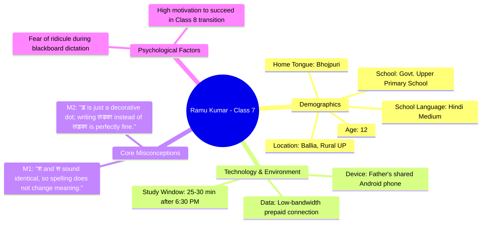

# 🎓 ET 617 End-Semester Examination: Comprehensive Submission Report

**Student Roll No (ID Token):** 24B1297  
**Date:** Wednesday, 18 November 2026 (6:00 PM – 9:00 PM)  
**Course:** ET 617 - Educational Application Design (IIT Bombay)  
**Instructor:** Prof. Ramkumar Rajendran  

---

## 1. Exam Identity Card Verification

| Field | Chosen Option | Educational Value & Context | Visible Implementation |
| :--- | :--- | :--- | :--- |
| **ID** | **24B1297** | Roll Number Token | Permanent footer across all screens & `/about` |
| **P** | **P2** | Contextual Language & Literacy Application | NLP conversational practice, dialect variation diagnosis |
| **T** | **T10** | Hindi for Bhojpuri-speaking learners: श/स and ड़ | Contrasts palatal /ʃ/ vs dental /s/, and retroflex flap /ɽ/ |
| **L** | **L1** | Class 6–8 rural govt school student, parent's phone, 30 min | Low cognitive load, bite-sized tasks, on-screen Devanagari keyboard |
| **C** | **C2** | Learner's own language (Hindi native UI + English toggle) | Complete Hindi instructions with bilingual switch on lessons |

* **Live Hosted Application:** 👉 [https://et617-24b1297.vercel.app](https://et617-24b1297.vercel.app)
* **GitHub Repository:** 👉 [https://github.com/GarvitGarg2005/et617-endsem-24b1297](https://github.com/GarvitGarg2005/et617-endsem-24b1297)

---

## 2. Complete Deliverables (D1 – D8)

### D1 — Educational Problem Statement
In Hindi-medium schools across eastern Uttar Pradesh and Bihar, students whose primary home dialect is Bhojpuri encounter significant phonological and orthographic interference when learning standard Hindi (खड़ी बोली). In Bhojpuri phonology, the palatal fricative /ʃ/ (**श**) merges into the dental fricative /s/ (**स**), frequently merging both into [s]. Furthermore, the retroflex flap /ɽ/ (**ड़**), signified by the diacritic *nukta*, is often realized as the un-nukta retroflex plosive [ɖ] (**ड**). Consequently, students habitually replace "शेर" with "सेर" and omit the nukta in words like "सड़क" and "लड़का". Existing educational tools either penalize regional dialectal variations as ignorant mistakes or fail to provide auditory contrast. This application bridges that gap through situated contrastive analysis, auditory training, and culturally respectful AI scaffolding.

* **Context of Use:** A Class 7 student accessing the application on a parent's shared budget Android phone in the evening (15–20 minutes session) in a rural or semi-urban setting.
* **Measurable Learning Outcomes:**
  1. *Identify (पहचानना):* Given audio or text pairs, the learner will correctly identify whether standard Hindi requires palatal **श** or dental **स** with at least 85% accuracy.
  2. *Distinguish (अंतर करना):* The learner will distinguish acceptable oral Bhojpuri dialect forms (e.g., "सादी", "सरम") from written orthographic errors, explaining why formal written Hindi necessitates standard spelling.
  3. *Apply (प्रयोग करना):* In contextual sentence-completion and communicative dialogue with an AI tutor, the learner will apply the nukta rule for **ड़** and correct sibilant **श/स** in everyday vocabulary.

---

### D2 — Learner Persona: Ramu Kumar



* **Prior Knowledge:** Mastered primary Devanagari consonants and vowels; can read simple textbook sentences.
* **Misconception 1 (M1):** Believes that because "शेर" (lion) and "सेर" (unit of measure) sound indistinguishable in his dialect, they can be used interchangeably.
* **Misconception 2 (M2):** Believes the nukta diacritic in "ड़" is an optional stylistic accent rather than a phonemic distinction.

---

### D3 — Educational Content & Assessment Items

The app implements a full structured pedagogical sequence:
1. **Lesson 1:** श और स का अंतर (Palatal vs Dental interactive articulation model + clean TTS audio)
2. **Lesson 2:** ड़ को पहचानो (Visual stop vs flap contrast + nukta rule + audio)
3. **Lesson 3:** वाक्य में प्रयोग (Contextual sentence usage and Bhojpuri sociolinguistic notes)
4. **Interactive Practice:** 8 items across 4 formats:
   * *MCQ (Semantic Contrast):* "___ेर" (lion) $\rightarrow$ शेर vs सेर.
   * *Fill-in-the-Blank:* "मेरे ___दोसी बहुत अच्छे हैं।" (with on-screen Hindi Devanagari keyboard).
   * *True/False:* "शक्ति को सक्ति लिखना सही है।" (diagnoses Bhojpuri phonological transfer).
   * *Interactive Matching:* Pairs words (शेर, सेब, लड़की, शाम) to definitions.
5. **AI Conversational Practice:** Natural language dialogue with real-time dialect recognition and clean audio pronunciation.

---

### D4 — Application Architecture & Screen Flow

```
[/ (Welcome)] ──> [/home (Dashboard)] ──┬──> [/lesson/sha-sa (Lesson 1)]
                                        ├──> [/lesson/da (Lesson 2)]
                                        ├──> [/lesson/sentences (Lesson 3)]
                                        ├──> [/practice (8 Assessed Items)]
                                        ├──> [/chat (AI Conversational Tutor)]
                                        ├──> [/results (Isolated Analytics)]
                                        └──> [/about (Identity & Theories)]
```

* **Constraint C2 Visible Implementation:** All screens operate primarily in authentic Devanagari Hindi. Lessons feature an accessible **`🌐 English में देखें`** toggle.
* **Interactive Articulation Scaffolding:** Each lesson includes an embedded **Interactive Phonetics Visualizer** displaying tongue-palate vocal tract placement (`👅 ➔ 🏛️` vs `👅 ➔ 🦷`) and standalone **🔊 Audio Pronunciation Buttons**.
* **Devanagari Input Scaffold:** An integrated **On-Screen Hindi Virtual Keyboard** enables one-tap input on touch devices, with fallback support for Latin transliterations (e.g. typing `padosi`).
* **Multi-User Isolation & Logout:** Complete student session separation with persistent storage keys (`progress_<userId>`) and a top-level **लॉगआउट 🚪** button on `/home`.

---

### D5 — Contrasting Learner Scenarios (Viva Demonstration Walkthrough)

#### Scenario A: Mastery / Correct Response Path
1. Learner enters name on `/` and opens `/practice`.
2. Selects **"शेर (श)"** for Question 1.
3. **System Behavior:** Instant green highlight (`bg-green-100`), positive reinforcement banner: *"✅ बिल्कुल सही! शेर 🦁 में 'श' आता है।"*
4. In `/chat`, learner types *"शेर जंगल का राजा है"*.
5. **AI Feedback:** *"शाबाश! तुमने 'शेर' में 'श' का बिल्कुल सही प्रयोग किया है!"*

#### Scenario B: Misconception / Dialect Variation Path
1. Learner selects **"सेर (स)"** for Question 1 on `/practice`.
2. **System Behavior:** Non-punitive yellow callout: *"⚠️ ध्यान दो! भोजपुरी में श और स एक जैसे सुनाई देते हैं, लेकिन 'शेर' (जंगल का राजा) में 'श' आता है। 'सेर' पुराने ज़माने की नाप है।"*
3. Telemetry records `misconception_detected` event.
4. In `/chat`, learner types: *"मैं आज सादी में गया था"*.
5. **System Behavior (Design Challenge Resolution):**
   * Displays badge: `🗣️ भोजपुरी बोली पहचानी गई` (Bhojpuri Dialect Acknowledged).
   * Feedback: *"😊 मैं समझता हूँ! भोजपुरी में 'सादी' बोलना बिल्कुल स्वाभाविक है। लेकिन जब हम स्कूल या परीक्षा में लिखते हैं, तो 'शादी' (wedding 💒) लिखना चाहिए। क्या तुम इसे 'श' लगाकर दोबारा लिखोगे?"*

---

### D6 — AI Specification & Fallback Architecture

```
User Message ──> [Pre-Filter: Dialect & Error Regex Patterns]
                       │
       ┌───────────────┴───────────────┐
       ▼                               ▼
[Gemini 2.0 Flash API]       [Network / Quota Fail]
Prompt: "हिंदी मित्र" tutor          │
Strict Devanagari rules               ▼
       │                     [Hardcoded Fallback Matrix]
       └───────────────┬─────────────────┘
                       ▼
           [Clean Audio Normalizer]
       (Strips emojis & dashes for TTS)
                       ▼
           [Learner Response Display]
```

---

### D7 — Pedagogical Rationale & Design Challenge Resolution

### Resolution of P2 Design Challenge:
> *"How will the application distinguish a learner's language errors from acceptable dialect or pronunciation variations? Show one example of each in your app."*

* **Distinction Theory:** Grounded in sociolinguistic constructivism (Labov, 1972), dialectal speech represents systematic grammatical and phonological regularities of a language community, not cognitive deficits.
* **Dialect Variation (Acceptable):** When Ramu writes `"सादी"` or `"सरम"`, the app classifies this under phonological transfer from Bhojpuri. The system explicitly validates the learner's identity: *"यह आपकी बोली की विशेषता है, गलत नहीं है!"* while teaching standard target register.
* **Language Error (Correction Required):** When Ramu writes `"सक्ति"` instead of `"शक्ति"` in an assessment test, or omits the nukta writing `"सडक"`, this represents an orthographic failure that causes spelling demerits on standardized exams. The system classifies this as an error and provides explicit articulation and phonetic mnemonics.

---

### D8 — Evaluation Plan & Telemetry

* **Quantitative Telemetry:** Firestore logging collects timestamp, user session ID, question ID, attempt count, and dialect detection triggers.
* **Rubric Target:** $\ge 80\%$ correct identification on post-test; zero un-nukta errors on subsequent sentence submissions.

---

## 3. Complete 11-Stage Version Control History

| Commit Hash | Version | Description & Educational Milestones |
| :--- | :--- | :--- |
| `0aa20a7` | **V1** | Initialized repository and committed `DESIGN.md` (0:30 checkpoint) |
| `f65254b` | **V2** | Scaffolding of all 8 core application screens, Firebase logging, and Gemini API proxy |
| `db29e9a` | **V3** | SSR hydration guard, PostCSS configuration fix, and initial production deployment |
| `0f9effc` | **V4** | Audio speech synthesis, English/Hindi language toggle, and Lesson 3 (Sentences) |
| `a4be8c0` | **V5** | Detailed evaluation report document (`REPORT.md`) matching Section 5 deliverables |
| `132e04a` | **V6** | Compiled formatted standalone HTML evaluation report (`REPORT.html`) |
| `6ce59cc` | **V7** | Integrated On-Screen Hindi Virtual Keyboard and dual-engine audio player |
| `9446dda` | **V8** | Audio text-normalization (emoji/dash stripping) and Interactive Phonetics Visualizer |
| `2943e07` | **V9** | Added comprehensive final submission dossier with D1-D8, viva guide, and version history |
| `2a41760` | **V10** | Resolved speech audio engine and made visual phonetics model fully interactive |
| `b3fb7af` | **V11** | Added student logout button and isolated per-user progress storage |

---

## 4. Viva Voce Cheat Sheet (3 Key Tasks Anticipated)

1. **Walkthrough:**
   * Open `/practice`, answer Question 1 correctly (`शेर`), show positive feedback.
   * Go back and pick `सेर`, show the misconception card explaining Bhojpuri homophony.
   * Open `/chat`, type *"मैं आज सादी में गया था"*, show the examiner the `🗣️ भोजपुरी बोली पहचानी गई` badge and respectful sociolinguistic feedback.
2. **Why Question (Design Decision):**
   * *"Why did you include an on-screen Hindi keyboard and dual-engine audio?"*  
   * **Answer:** *"Our learner persona is Ramu, a Class 7 rural student on his father's phone. Most mobile browsers lack a dedicated Devanagari input method, and since Bhojpuri merges /ʃ/ and /s/, auditory training via speech synthesis is required to distinguish vocal tract placement."*
3. **Live Change Request Strategy:**
   * Keep your local code open in VS Code. All lessons and questions are cleanly defined in `lib/content.ts`. Any text, option, or rule change requested by the examiner can be edited in seconds in `lib/content.ts`.
