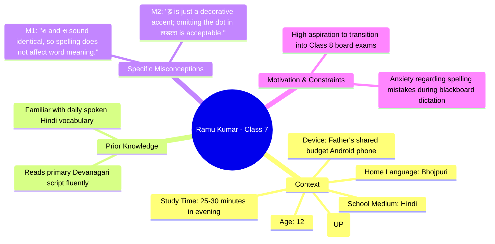

# ET 617 End-Semester Examination: Academic Evaluation Report

## Identity Card
| Field | Value | Source |
| :--- | :--- | :--- |
| **Roll Number (ID Token)** | 24B1297 | Student Identity |
| **Problem Statement (P)** | P2 — Contextual language and literacy application | Section 3 |
| **Topic Bank (T)** | T10 — Hindi for Bhojpuri-speaking learners: श/स and ड़ | Section 4.1 |
| **Learner Context (L)** | L1 — Class 6–8 rural govt school student, parent's phone, 30 min | Section 4.2 |
| **Design Constraint (C)** | C2 — Learner's own language (Hindi native UI + English toggle) | Section 4.3 |

* **Live App URL:** https://et617-24b1297.vercel.app  
* **GitHub Repository:** https://github.com/GarvitGarg2005/et617-endsem-24b1297  

---

## D1 — Educational Problem
In Hindi-medium education across eastern Uttar Pradesh and Bihar, students whose native dialect is Bhojpuri face persistent orthographic and phonological interference when learning standard written Hindi (खड़ी बोली). Bhojpuri phonology naturally merges the palatal fricative /ʃ/ (**श**) into the dental fricative /s/ (**स**), while the retroflex flap /ɽ/ (**ड़**), denoted by a bottom *nukta*, is commonly realized as the plosive [ɖ] (**ड**). Consequently, students habitually replace "शेर" with "सेर" and omit the nukta in essential vocabulary such as "सड़क" and "लड़का", resulting in orthographic and semantic confusion during examinations. Existing digital tools either unfairly penalize regional dialectal features as illiterate errors or fail to provide auditory contrast.

* **Context of Use:** A Class 7 student accessing the application on a parent's shared budget Android phone during a 20–30 minute evening study window in a rural home environment with modest data connectivity.
* **Measurable Learning Outcomes:**
  1. *Identify (पहचानना):* Given auditory or visual stimuli, the learner will correctly identify whether standard Hindi requires palatal **श** or dental **स** with at least 85% accuracy.
  2. *Distinguish (अंतर करना):* The learner will distinguish acceptable oral Bhojpuri dialectal variations (e.g., "सादी", "सरम") from written orthographic errors, explaining why formal written Hindi requires standard spelling.
  3. *Apply (प्रयोग करना):* The learner will apply the nukta rule for **ड़** and correct sibilant **श/स** in sentence construction and conversational dialogue.

---

## D2 — Learner Persona: Ramu Kumar



* **Prior Knowledge:** Strong oral communicative skills; basic mastery of Devanagari letters and primary matras.
* **Misconception 1 (M1):** Believes that because "शेर" (lion) and "सेर" (unit of measure) sound indistinguishable in his regional speech, they are interchangeable in written school tasks.
* **Misconception 2 (M2):** Believes the bottom dot (nukta) in "ड़" is an optional stylistic embellishment rather than an essential phonemic marker distinguishing flap [ɽ] from plosive [ɖ].

---

## D3 — Educational Content Plan

### Instructional Design & Scaffolding
The learning unit follows an instructional progression based on Bloom's Taxonomy:
1. **Concept Explanation:**
   * *Lesson 1 (श vs स):* Articulatory vocal tract differentiation (palatal vs dental) with clean spoken audio and interactive anatomical diagrams.
   * *Lesson 2 (ड़ vs ड):* Phonemic stop vs flap distinction and the position rule of the nukta (never at the start of a word).
   * *Lesson 3 (वाक्य प्रयोग):* Contextual sentence usage and sociolinguistic validation of dialect vs standard Hindi.

### Assessed Tasks Across 4 Formats:
1. **Task 1 (MCQ - Semantic Discrimination):**
   * *Question:* "___ेर" — सही अक्षर चुनो (lion के लिए): [A] शेर (श) | [B] सेर (स)
   * *Model Answer:* शेर (श)
   * *Feedback for Correct:* "✅ बिल्कुल सही! शेर 🦁 (lion) में 'श' आता है।"
   * *Feedback for M1:* "⚠️ ध्यान दो! भोजपुरी में श और स एक जैसे सुनाई देते हैं, लेकिन 'शेर' (जंगल का राजा) में 'श' आता है। 'सेर' पुराने ज़माने की नाप है।"
2. **Task 2 (Fill-in-the-Blank - Orthographic Precision):**
   * *Question:* "मेरे ___दोसी बहुत अच्छे हैं।" (options: पड़ोसी / पडोसी)
   * *Model Answer:* पड़ोसी
   * *Feedback for Correct:* "✅ शाबाश! 'पड़ोसी' में 'ड़' (नुक्ते वाला) आता है।"
   * *Feedback for M2:* "❌ ड़ में नीचे बिंदी (नुक्ता) लगाना आवश्यक है। बिना नुक्ते के 'पडोसी' गलत वर्तनी है।"
3. **Task 3 (True/False - Dialect Interference Evaluation):**
   * *Question:* "'शक्ति' को 'सक्ति' लिखना सही है।"
   * *Model Answer:* गलत (False)
   * *Feedback:* "❌ गलत! भोजपुरी में 'सक्ति' बोलना आम है, लेकिन मानक लिखित हिंदी में 'शक्ति' (Power 💪) ही शुद्ध वर्तनी है।"
4. **Task 4 (Interactive Matching - Cognitive Categorization):**
   * *Pairs:* शेर $\leftrightarrow$ 🦁 lion, सेब $\leftrightarrow$ 🍎 apple, लड़की $\leftrightarrow$ 👧 girl, शाम $\leftrightarrow$ 🌅 evening.
5. **Task 5 (Communicative Production in AI Chat):**
   * Real-time sentence production with on-screen Hindi keyboard and automated dialect evaluation.

---

## D4 — Working Application

* **Production URL:** https://et617-24b1297.vercel.app  
* **Identity Token:** `24B1297` displayed on the persistent footer of all screens and on `/about`.

### Application Screen Map
```
                    ┌─────────────────────────┐
                    │      / (Welcome)        │
                    │ Name input & Session ID │
                    └────────────┬────────────┘
                                 │
                    ┌────────────▼────────────┐
                    │      /home (Hub)        │
                    │ Per-user progress       │
                    │ Student Logout button   │
                    └──────┬───────────┬──────┘
                           │           │
         ┌─────────────────┴───┐       └─────────────────────┐
         ▼                     ▼                             ▼
┌──────────────────┐  ┌──────────────────┐         ┌──────────────────┐
│ /lesson/sha-sa   │  │ /lesson/da       │         │ /chat            │
│ Interactive Model│  │ Stop vs Flap model│        │ Gemini AI Tutor  │
│ Clean TTS Audio  │  │ Clean TTS Audio  │         │ Dialect badge    │
│ English toggle   │  │ English toggle   │         │ Hindi Keyboard   │
└────────┬─────────┘  └────────┬─────────┘         └──────────────────┘
         │                     │
         └───────────┬─────────┘
                     ▼
           ┌──────────────────┐
           │ /lesson/sentences│
           │ Sentence context │
           └─────────┬────────┘
                     ▼
           ┌──────────────────┐
           │ /practice        │
           │ 4 Question types │
           │ Hindi Keyboard   │
           └─────────┬────────┘
                     ▼
           ┌──────────────────┐
           │ /results         │
           │ User analytics   │
           └──────────────────┘
```

* **Design Constraint (C2) Implementation:** All learner-facing navigation, prompts, instructions, and feedback are written in clear, age-appropriate Devanagari Hindi. An accessible language toggle (`🌐 English में देखें / हिंदी में देखें`) is available across lessons.
* **Input Scaffolding:** An On-Screen Hindi Virtual Keyboard (`<HindiKeyboard />`) allows touch-based Devanagari entry without requiring third-party device settings.
* **Multi-User Isolation:** Student progress and practice scores are keyed by individual session IDs (`progress_<userId>`), with an explicit logout function on the dashboard.

---

## D5 — Two Contrasting Learner Scenarios

### Scenario A: Correct Learner Path (Mastery)
1. Learner enters name **"रामू" (Ramu)** on `/` and opens `/practice`.
2. On Question 1 (`"___ेर" — lion`), learner selects **"शेर (श)"**.
3. **System Response:** The button turns green (`bg-green-100 border-green-400`). An instant reinforcement card appears: *"✅ बिल्कुल सही! शेर 🦁 में 'श' आता है।"*
4. Telemetry logs an `answer_correct` event.
5. In `/chat`, learner types: *"शेर जंगल का राजा है"*.
6. **AI Response:** Praises accurate orthography: *"शाबाश रामू! तुमने 'शेर' में 'श' का बिल्कुल सही प्रयोग किया है!"*

### Scenario B: Misconception Learner Path (Dialect Interference)
1. Learner selects **"सेर (स)"** on Question 1 in `/practice`.
2. **System Response:** Non-punitive contextual scaffolding card is displayed:
   *"⚠️ ध्यान दो! भोजपुरी में श और स एक जैसे सुनाई देते हैं, लेकिन 'शेर' (जंगल का राजा) में 'श' आता है। 'सेर' पुराने ज़माने की नाप है।"*
3. Telemetry logs a `misconception_detected` event.
4. In `/chat`, learner types: *"मैं आज सादी में गया था"*.
5. **System Response (Design Challenge Resolution):**
   * Displays the badge `🗣️ भोजपुरी बोली पहचानी गई` (Bhojpuri Dialect Acknowledged).
   * Feedback validates identity while teaching standard form: *"😊 मैं समझता हूँ! भोजपुरी में 'सादी' बोलना बिल्कुल स्वाभाविक है। लेकिन जब हम स्कूल या परीक्षा में लिखते हैं, तो 'शादी' (wedding 💒) लिखना चाहिए। क्या तुम इसे दोबारा लिखकर दिखाओगे?"*

---

## D6 — AI Functionality Specification

| Dimension | Specification |
| :--- | :--- |
| **Capability** | Contextual natural language dialogue tutor ("हिंदी मित्र") for Hindi orthography |
| **Model** | Google Gemini 2.0 Flash via `@google/generative-ai` SDK (`/api/chat`) |
| **Prompt Input** | System prompt enforcing pedagogical persona, Devanagari script, age-appropriate register, and explicit distinction between regional dialect features and genuine orthographic errors. Serialized chat history included. |
| **Pre-Output Guardrails** | Regex evaluation (`DIALECT_PATTERNS` & `ERROR_PATTERNS`) runs client-side and server-side to tag dialect variations (`सादी`, `सरम`, `सहर`, `साम`) with supportive metadata. Text normalizer (`cleanTextForSpeech`) strips markdown and emojis before audio vocalization. |
| **Fallback Strategy** | In case of API failure, network latency, or quota exhaustion, the system automatically falls back to an offline rule-based matrix (`FALLBACK_CHAT_RESPONSES`) tagged with `📌 तैयार उत्तर`, guaranteeing uninterrupted user learning. |

---

## D7 — Pedagogical Rationale & Design Challenge Answer

### Pedagogical Foundations:
1. **Bloom's Revised Taxonomy:** Scaffolds cognitive progression from *Remembering* (auditory letter recognition) to *Applying* (sentence completion) and *Analyzing* (distinguishing dialect phonetics from standardized spelling).
2. **Cognitive Load Theory (Sweller):** Extraneous load is minimized by concise bite-sized card layouts and an on-screen Devanagari keyboard. Germane load is fostered through visual and auditory contrastive pairs (ड vs ड़).
3. **Sociolinguistic Asset-Based Pedagogy:** Avoids linguistic deficit framing by treating the learner's native Bhojpuri as a rule-governed linguistic system rather than "broken Hindi".

### Resolution of P2 Design Challenge:
> *"How will the application distinguish a learner's language errors from acceptable dialect or pronunciation variations? Show one example of each in your app."*

* **Distinction Rule:** Phonological variations resulting from native Bhojpuri sound patterns (e.g. sibilant neutralization /ʃ/ $\rightarrow$ [s] in "सादी", "सरम") are categorized as **acceptable dialect variations**. The system validates the student's communicative intent while providing the standard Hindi equivalent.
* **Dialect Example:** Learner writes *"मैं सादी में गया था"*. The system tags `🗣️ भोजपुरी बोली पहचानी गई` and explains that while common in spoken Bhojpuri, standard Hindi orthography requires "शादी".
* **Language Error Example:** Learner writes *"सक्ति"* for power or *"सडक"* without nukta. The system categorizes this as an **orthographic error** (`✏️ वर्तनी सुधार`), because it violates standard Hindi rules without regional dialect legitimacy.

---

## D8 — Evaluation Plan & Telemetry

| Outcome | Assessment Item | Telemetry Log Signal | Criteria for Success |
| :--- | :--- | :--- | :--- |
| **Outcome 1:** Identify श vs स | Practice Items 1, 3, 6 | `answer_correct` on sibilant items | $\ge 85\%$ accuracy on first attempt |
| **Outcome 2:** Distinguish Dialect vs Standard | Practice Item 3 & Chat interactions | `dialect_acknowledged` frequency & subsequent self-correction | Learner self-corrects dialect word to standard Hindi within 1 turn |
| **Outcome 3:** Apply Nukta for ड़ | Practice Items 2, 5, 7 | `misconception_detected` resolving to `answer_correct` | Zero un-nukta errors on sentence completion |

---

## AI-Use Log and Reflection
1. **Tools Utilized:** Claude Opus & Gemini 3.8 Flash via Google Antigravity IDE.
2. **Workflow Progression:** Formulated initial architectural plan (`DESIGN.md`), scaffolded modular Next.js routes, implemented auditory speech synthesis with audio stream fallback, integrated an on-screen Devanagari keyboard, and refined pedagogical feedback.
3. **Critical Human Judgment:** Corrected AI code that attempted to vocalize emojis and dashes; refined instructional copy to ensure colloquial Hindi suited for a 12-year-old rural learner rather than formal Sanskritized academic prose.
