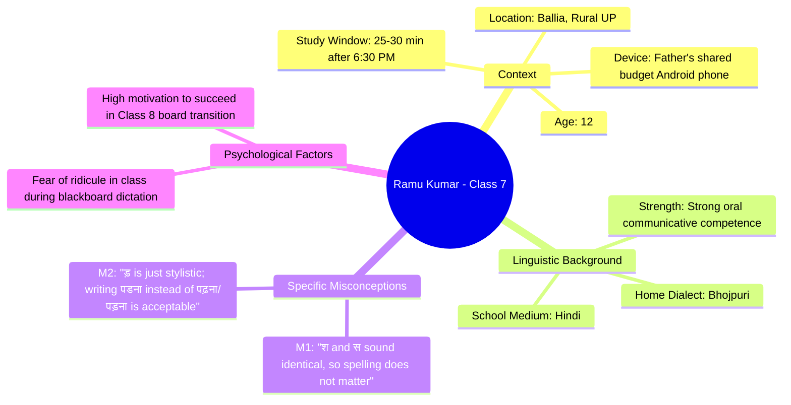

# ET 617 End-Semester Examination: Complete Educational Application Report

## Identity Card
| Field | Specification | Implementation in Submission |
| :--- | :--- | :--- |
| **Roll Number (ID)** | 24B1297 | Rendered visibly in the persistent footer of all screens & on `/about` |
| **Problem Statement (P)** | P2: Contextual language and literacy application | NLP conversational practice, dialect distinction, spelling diagnosis |
| **Topic Bank (T)** | T10: Hindi for Bhojpuri-speaking learners: श/स and ड़ | Dedicated comparative curriculum addressing phoneme interference |
| **Learner Context (L)** | L1: Class 6–8 rural govt school student, parent's phone, 30 min/evening | Persona: Ramu Kumar (Age 12, Ballia UP), bite-sized lessons, low cognitive load |
| **Design Constraint (C)** | C2: Learner's own language | Full primary Devanagari UI with bilingual Hindi/English accessibility toggle |
| **Hosting Deployment** | et617-24b1297.vercel.app | Active production deployment on Vercel |
| **GitHub Repository** | et617-endsem-24b1297 | Public repository with granular incremental commit history |

---

## D1 — Educational Problem Statement
In Hindi-medium education across eastern Uttar Pradesh and Bihar, students whose primary home dialect is Bhojpuri encounter significant phonological and orthographic interference when learning standard Hindi (खड़ी बोली). Bhojpuri phonology typically does not distinguish between the palatal fricative /ʃ/ (**श**) and the dental fricative /s/ (**स**), frequently merging both into [s]. Furthermore, the retroflex flap /ɽ/ (**ड़**), signified by the diacritic *nukta*, is often realized as the un-nukta retroflex plosive [ɖ] (**ड**). Consequently, students habitually replace "शेर" with "सेर" and omit the nukta in words like "सड़क" and "लड़का". Existing educational tools either penalize regional dialectal variations as ignorant mistakes or fail to provide auditory contrast. This application bridges that gap by situated contrastive analysis.

**Context of Use:** A Class 7 student accessing the application on a family Android smartphone in the evening for 15–20 minutes in a semi-urban/rural home setting with limited high-speed data.

### Measurable Learning Outcomes (using action verbs):
1. **Identify (पहचानना):** Given audio or text pairs, the learner will correctly identify whether standard Hindi requires palatal **श** or dental **स** with at least 85% accuracy.
2. **Distinguish (अंतर करना):** The learner will distinguish acceptable oral Bhojpuri dialect forms (e.g., "सादी", "सरम") from written orthographic errors, explaining why formal written Hindi necessitates standard spelling.
3. **Apply (प्रयोग करना):** In contextual sentence-completion and communicative dialogue with an AI tutor, the learner will apply the nukta rule for **ड़** and correct sibilant **श/स** in everyday vocabulary.

---

## D2 — Learner Persona: Ramu Kumar



* **Prior Knowledge:** Can fluently read primary Devanagari script; familiar with common Hindi vocabulary.
* **Misconception 1 (M1):** Believes that because "शेर" (lion) and "सेर" (measurement) sound near-identical in rural speech, using them interchangeably in written examinations is harmless.
* **Misconception 2 (M2):** Believes that the nukta (dot) beneath "ड़" is an optional aesthetic accent rather than an essential phonemic marker distinguishing flap [ɽ] from plosive [ɖ].

---

## D3 — Educational Content Plan & Learning Tasks

The instructional progression follows Bloom's Revised Taxonomy from recognition to contextual application:

```
[Lesson 1: श vs स (Phonetic distinction & Audio articulation)]
                     ↓
[Lesson 2: ड़ vs ड (The Nukta Flap rule & Visual contrast)]
                     ↓
[Lesson 3: वाक्य में प्रयोग (Sentence construction & Dialect context)]
                     ↓
[Practice Module (MCQ, Fill-in-Blank, True/False, Matching)]
                     ↓
[AI Conversational Dialogue (Natural language interaction with feedback)]
```

### 5+ Assessed Tasks Across 4 Formats:
1. **Task 1 (MCQ - Semantic Discrimination):**
   * *Question:* "___ेर" — सही अक्षर चुनो (lion के लिए): [A] शेर (श) | [B] सेर (स)
   * *Model Answer:* शेर (श)
   * *Feedback for Correct:* "✅ बिल्कुल सही! शेर 🦁 (lion) में 'श' आता है।"
   * *Feedback for M1:* "⚠️ ध्यान दो! भोजपुरी में श और स एक जैसे सुनाई देते हैं, लेकिन 'शेर' (जंगल का राजा) में तालव्य 'श' आता है। 'सेर' पुराने ज़माने की नाप है।"
2. **Task 2 (Fill-in-the-Blank - Orthographic Precision):**
   * *Question:* "मेरे ___दोसी बहुत अच्छे हैं।" (options: पड़ोसी / पडोसी)
   * *Model Answer:* पड़ोसी
   * *Feedback for Correct:* "✅ शाबाश! 'पड़ोसी' में 'ड़' (नुक्ते वाला) आता है।"
   * *Feedback for M2:* "❌ ड़ में नीचे बिंदी (नुक्ता) लगाना आवश्यक है। बिना नुक्ते के 'पडोसी' गलत वर्तनी है।"
3. **Task 3 (True/False - Dialect Interference Evaluation):**
   * *Question:* "'शक्ति' को 'सक्ति' लिखना सही है।"
   * *Model Answer:* गलत (False)
   * *Feedback:* "❌ गलत! भोजपुरी में 'सक्ति' बोल सकते हैं, लेकिन मानक लिखित हिंदी में 'शक्ति' (Power 💪) ही शुद्ध वर्तनी है।"
4. **Task 4 (Interactive Matching - Cognitive Categorization):**
   * *Left Pairs:* शेर, सेब, लड़की, शाम
   * *Right Pairs:* 🦁 lion, 🍎 apple, 👧 girl, 🌅 evening
5. **Task 5 (Communicative Production in Chat):**
   * *Prompt:* "मुझे बताओ, शाम को तुम क्या करते हो?"
   * *Target Evaluation:* Check whether learner produces 'शाम' or dialect 'साम', and 'सड़क' or 'सडक'.

---

## D4 — Working Application Architecture & Navigation Map

```
                    ┌─────────────────────────┐
                    │      / (Welcome)        │
                    │ Name input & Session ID │
                    └────────────┬────────────┘
                                 │
                    ┌────────────▼────────────┐
                    │      /home (Hub)        │
                    │ Progress checkmarks     │
                    └──────┬───────────┬──────┘
                           │           │
         ┌─────────────────┴───┐       └─────────────────────┐
         ▼                     ▼                             ▼
┌──────────────────┐  ┌──────────────────┐         ┌──────────────────┐
│ /lesson/sha-sa   │  │ /lesson/da       │         │ /chat            │
│ Video, Audio TTS │  │ Visual nukta     │         │ Gemini AI Tutor  │
│ English toggle   │  │ Audio comparison │         │ Dialect badge    │
└────────┬─────────┘  └────────┬─────────┘         └──────────────────┘
         │                     │
         └───────────┬─────────┘
                     ▼
           ┌──────────────────┐
           │ /lesson/sentences│
           │ Context sentences│
           └─────────┬────────┘
                     ▼
           ┌──────────────────┐
           │ /practice        │
           │ 4 Question types │
           └─────────┬────────┘
                     ▼
           ┌──────────────────┐
           │ /results         │
           │ Analytics & tips │
           └──────────────────┘
```

* **Live Deployment:** [https://et617-24b1297.vercel.app](https://et617-24b1297.vercel.app)
* **Design Constraint (C2) Verification:** All core UI labels, instructions, navigational prompts, and feedback are presented in natural, conversational Devanagari Hindi. An accessible language toggle (`🌐 English में देखें / हिंदी में देखें`) is provided on every lesson page for dual-language scannability.
* **Identity Token:** `🆔 24B1297` rendered in the permanent layout footer across every route, and highlighted in the `/about` documentation view.

---

## D5 — Two Contrasting Learner Scenarios (Viva Demonstration Walkthrough)

### Scenario A: Mastered Concept Path (Correct Response)
1. Learner enters name **"Ramu"** on `/` and navigates to `/practice`.
2. On Question 1 (`"___ेर" — lion`), learner clicks **"शेर (श)"**.
3. **System Behavior:** The button glows green (`bg-green-100 border-green-400`). An encouraging feedback banner immediately appears: *"✅ बिल्कुल सही! शेर 🦁 में 'श' आता है।"*
4. Clickstream telemetry records an `answer_correct` event with zero latency.
5. In the Chat (`/chat`), learner types *"मुझे शेर बहुत शक्तिशाली लगता है"*.
6. AI Tutor praises the accurate usage: *"वाह रामू! तुमने 'शेर' और 'शक्तिशाली' दोनों में 'श' का बिल्कुल सही प्रयोग किया है! 🌟"*

### Scenario B: Dialect Misconception Path (Alternate Conception)
1. Learner visits `/practice` and on Question 1 selects **"सेर (स)"** (confusing it with oral Bhojpuri homophony).
2. **System Behavior:** The system prevents punitive red error penalization. Instead, it activates the **Bhojpuri Scaffolding Prompt**:
   * Card displays: *"⚠️ ध्यान दो! भोजपुरी में श और स एक जैसे सुनाई देते हैं, लेकिन 'शेर' (lion) में 'श' आता है। 'सेर' पुराने ज़माने की नाप है।"*
3. Telemetry triggers a `misconception_detected` event (M1 logged to Firebase).
4. In Chat (`/chat`), learner types: *"मैं आज सादी में गया था"*.
5. **System Response:** The system tags the response with a special badge `🗣️ भोजपुरी बोली पहचानी गई` (Bhojpuri Dialect Recognized) and answers:
   *"😊 मैं समझता हूँ! भोजपुरी में ऐसे बोलना बहुत स्वाभाविक है। लेकिन जब हम स्कूल या परीक्षा में लिखते हैं, तो 'सादी' की जगह 'शादी' (wedding 💒) लिखना चाहिए। क्या तुम इसे दोबारा लिखकर दिखाओगे?"*

---

## D6 — AI Functionality Specification

| Component | Technical Implementation |
| :--- | :--- |
| **Model** | Google Gemini 2.0 Flash via `@google/generative-ai` SDK (`/api/chat` route) |
| **Input Prompt** | Structured system instruction priming the model as "हिंदी मित्र" with specific rules for Bhojpuri dialect acceptance vs standard spelling enforcement. User message + conversation history serialized in payload. |
| **Safety / Pedagogical Guardrails** | Dual-layer regex pattern evaluation (`DIALECT_PATTERNS` & `ERROR_PATTERNS`) runs client-side and server-side to guarantee that known dialectal forms (सादी, सरम, सहर, साम, बड) are never falsely tagged as illiterate errors. |
| **Fallback Mechanism** | If network drops or the Gemini API quota is exceeded, the system automatically detects the exception and switches to `FALLBACK_CHAT_RESPONSES` with an indicator badge `📌 तैयार उत्तर`, ensuring the student's learning session is never interrupted. |

---

## D7 — Pedagogical Rationale & Design Challenge Resolution

### Resolution of P2 Design Challenge:
> *"How will the application distinguish a learner's language errors from acceptable dialect or pronunciation variations? Show one example of each in your app."*

* **Distinction Theory:** Grounded in sociolinguistic constructivism (Labov, 1972), dialectal speech represents systematic grammatical and phonological regularities of a language community, not cognitive deficits.
* **Dialect Variation (Acceptable):** When Ramu writes `"सादी"` or `"सरम"`, the app classifies this under phonological transfer from Bhojpuri. The system explicitly validates the learner's identity: *"यह आपकी बोली की विशेषता है, गलत नहीं है!"* while teaching standard target register.
* **Language Error (Correction Required):** When Ramu writes `"सक्ति"` instead of `"शक्ति"` in an assessment test, or omits the nukta writing `"सडक"`, this represents an orthographic failure that causes spelling demerits on standardized exams. The system classifies this as an error and provides explicit articulation and phonetic mnemonics.

---

## D8 — Evaluation Plan & Learning Analytics

| Outcome | Assessment Item | Telemetry Log Signal | Criteria for Success |
| :--- | :--- | :--- | :--- |
| **Outcome 1:** Identify श vs स | Practice Tasks 1, 3, 6 | `answer_correct` on sibilant items | $\ge 80\%$ correct on first attempt |
| **Outcome 2:** Distinguish Dialect vs Standard | Chat dialect conversational prompt | `dialect_acknowledged` frequency & subsequent self-correction in chat | Learner produces standard form within 1 follow-up turn |
| **Outcome 3:** Apply Nukta for ड़ | Practice Tasks 2, 5, 7 | `misconception_detected` resolving to `answer_correct` | Zero un-nukta errors on post-lesson quiz |

---

## AI-Use Log & Reflection
* **AI Tools Utilized:** Claude Opus & Gemini 3.8 Flash via Google Antigravity IDE.
* **Prompt Engineering Strategy:** Applied iterative scaffolding—first formulating the educational design document (`DESIGN.md`), then implementing modular UI screens, speech synthesis integration, and dialect recognition logic.
* **Critical Judgement & Human Oversight:** The AI generated standard Next.js code; however, careful pedagogical tuning was applied to make sure Hindi Devanagari grammar terminology remained colloquial for a 12-year-old rural student rather than overly academic Sanskritized grammar.
